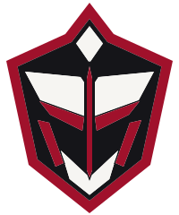

# The logo — Polka Portals shield

The shield mask is the Polka Portals logo ([ADR-0015](../../00_START_HERE/decisions/ADR-0015-shield-logo.md)); the name is set as the wordmark beside or below it. The hooded [Phantom](the-phantom.md) is the character, never the logo.

## Anatomy
On a 200 × 240 grid, mirrored about the centre line, in three inks:
- **Crowned shield** — a crimson rim, notched at the crown, tapering to a point.
- **Ink face**, separated from the rim by an ink band.
- **Paper diamond** at the crown and two **paper brow plates**.
- **Crimson** eye bars, fangs and the central **spine** (the one crimson mark that runs the full height).
- **Paper V-jaw** with a notch where the spine ends.
- An ink hairline wherever crimson crosses paper.

## Files ([30_ASSETS/brand](../../30_ASSETS/brand/))
| Need | Use |
|---|---|
| The logo, on paper or ink | `shield/polka-shield.svg` (PNG `-512`, `-2048`) |
| Shield + name, documents, headers, slides | `logo/polka-lockup-horizontal.svg` (on ink: `-horizontal-inverse.svg`) |
| Splash, posters, covers, square formats | `logo/polka-lockup-stacked.svg` |
| Name alone | `wordmark/polka-wordmark.svg`, `-inverse.svg` — Space Grotesk 700, outlined, tracking +0.20 em |
| One colour (print, stamps, embossing) | `shield/polka-shield-mono-ink.svg`, `-mono-paper.svg` |
| Line art (spec sheets, laser) | `shield/polka-shield-outline.svg` |
| 16–47 px (favicon, tab, tray, dense lists) | `shield/polka-shield-small.svg`, `polka-favicon.ico`, `polka-favicon-16/32/48.png` |
| Avatar, sticker, medallion | `shield/polka-shield-badge.svg` |
| App / PWA icon | `shield/polka-app-icon.svg` (full-bleed ink; the platform masks the corners), `-1024.png`, `-180.png` |

## Rules
- **Clear space:** half the shield's width on every side; for the wordmark, its cap height.
- **Minimum size:** 48 px tall for the full shield; from 16 to 47 px use the small shield; wordmark at least 120 px wide on screen, 30 mm in print.
- **Three inks only:** ink `#151519`, paper `#F6F5F2`, crimson `#A0112B`. On photography or busy art use the one-colour shield on an ink or paper plate.
- **Never** recolour, outline, rotate, stretch, add shadows, glows or textures, crop the rim, or set the wordmark in crimson or another font.
- **One shield per surface.** Never merge it with the Phantom: the shield sits in the chrome (header, footer, corner), the Phantom is the art.
- **Edit the generator, not the files:** every logo file is drawn by `80_TOOLS/generators/make-shield-logo.py`; change the geometry there and re-run.
