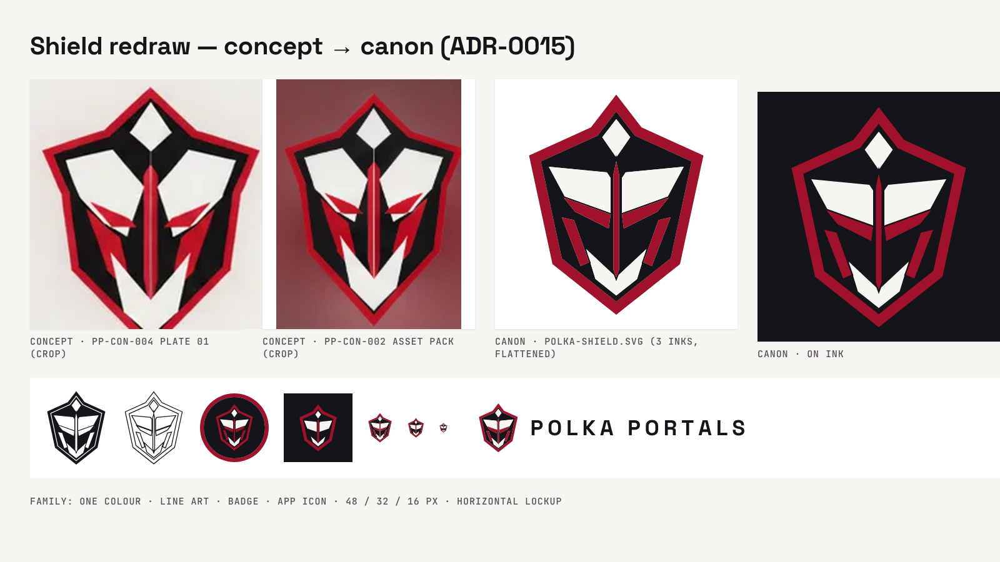

# Polka Portals canon — v1.3.0

**Released 2026-10-31.** The project is renamed **Polka Portals** ([ADR-0014](../../00_START_HERE/decisions/ADR-0014-rename-polka-portals.md)), and the **shield mask** is its logo, redrawn as clean vectors ([ADR-0015](../../00_START_HERE/decisions/ADR-0015-shield-logo.md)). The hooded Phantom stays as the character. Full list: [CHANGELOG](../../00_START_HERE/CHANGELOG.md).



## New
- 20 logo files (PP-BRAND-013 … 032):
  - the shield and its one-colour, line-art, small and badge versions
  - the app icon, PNGs and favicons
  - the POLKA PORTALS wordmark and three lockups
- All of them come from one generator, `80_TOOLS/generators/make-shield-logo.py`, with geometry on a 200 × 240 grid, three inks and flattened paths.
- [logo.md](../../10_DESIGN_SYSTEM/visual-language/logo.md): usage and rules. The brand board opens with a logo page (10 pages).

## Changed
- The name, in every place a person reads it. Identifiers and history keep the old name (ADR-0014).
- Logo slots use the shield: gallery, starter, deck, inventory screen, media templates, Canva kit sheet and brand board.
- The Phantom emblem masters moved to `brand/phantom-hero/` as character art.
- Concept sheets are now REFERENCE.
- The Codex hand-off gains a name-and-logo addendum.

## Retired
- The reaper monogram, app icon and lockup, and the PHANTOM PORTALS wordmark. They are now in `90_ARCHIVE/brand-marks-phantom-2026-10-31/` (sealed).

## Verified
- `validate-canon.py` → 11/11. The archive was resealed (95 files), and the asset index lists 98 assets with 0 problems.
- **Logo render checks**:
  - Every SVG renders in Chromium. Small sizes were checked at 48, 32 and 16 px.
  - The primary shield was compared side by side with the concept crops (the image above).
  - The brand board renders 10 pages with no overflow and no console errors, with all five canon fonts loaded.
- **Page checks**: gallery, starter, deck and artifact inventory (1440 and 390 px) were each opened from `file://` with the network blocked. Each had 0 console errors, 0 failed or external requests, 0 broken images and no horizontal scroll, and its favicon resolved to the shield.
- **Template checks**: the YouTube thumbnail and channel banner render with the new lockup.

## Open
- **Owner decisions:**
  - C-11, the PHANTOM USB name
  - C-01, shell sizes
  - C-03, page architecture
  - C-04, the missing v3.1 package
  - C-06, canvas mockup art
  - whether the inventory's game vocabulary is a fiction layer
- **Canva sync** needs the owner's approval.
- **Figma** connector is not enabled.
- **Trademark search** has not been run.
- **GitHub**: the repository is still public, so nothing is pushed.

## Verify
```bash
cd PHANTOM_PORTALS_CANON
sha256sum -c 99_RELEASES/v1.3.0/MANIFEST.sha256 --quiet && echo "release intact"
python3 80_TOOLS/validate-canon.py
```
